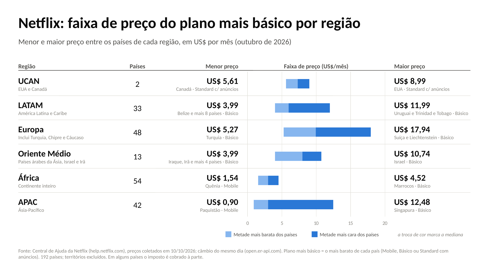

# Netflix: preço por país e região

Coleta dos preços de todos os planos da Netflix em todos os países, a partir da Central de Ajuda. Os preços foram convertidos para US$ com o câmbio do mesmo dia. Em cima disso, há três análises:

- a faixa de preço (mínimo a máximo) do plano mais básico em cada região;
- o preço como % do consumo das famílias;
- um teste da tese "a Netflix perde tempo de TV para o YouTube" (EUA, Nielsen).

**Data da coleta:** as páginas foram baixadas em 10/10/2026, até 14:20 UTC. O câmbio usado foi publicado em 10/10/2026 às 00:02 UTC.

## Faixa de preço do plano mais básico (US$/mês)



| Região | Países | Mínimo | Mediana | Máximo |
|---|---:|---|---:|---|
| UCAN | 2 | 5,61 (Canadá, Standard c/ anúncios) | 7,30 | 8,99 (EUA, Standard c/ anúncios) |
| LATAM | 33 | 3,99 (Belize e mais 8 países) | 5,99 | 11,99 (Uruguai, Trinidad e Tobago) |
| Europa | 48 | 5,27 (Turquia) | 9,93 | 17,94 (Suíça, Liechtenstein) |
| Oriente Médio | 13 | 3,99 (Iraque, Irã e mais 4 países) | 7,99 | 10,74 (Israel) |
| África | 54 | 1,54 (Quênia, Mobile) | 2,99 | 4,52 (Marrocos) |
| APAC | 42 | 0,90 (Paquistão, Mobile) | 2,99 | 12,48 (Singapura) |

- **Plano mais básico:** o mais barato oferecido em cada país. Pode ser Mobile, Básico ou Standard com anúncios.
- **Sem o Mobile:** o mínimo da África passa a ser o Egito (US$ 2,10). O de APAC continua o Paquistão (US$ 1,63, Básico).
- **Países:** só países (192); territórios ficam de fora desta tabela.

## Arquivos

| Arquivo | O que faz / o que é |
|---|---|
| `netflix_scraper.py` | Baixa a página de preços de cada código ISO de país, lê os planos e converte para US$. Também classifica cada país em UCAN, LATAM, EMEA ou APAC. |
| `resultado_netflix/netflix_todos_os_planos.csv` | Todos os planos de todos os países (816 linhas). |
| `resultado_netflix/netflix_plano_basico_por_pais.csv` | Plano mais básico de cada país e território (245 linhas, das quais 192 são países). |
| `resultado_netflix/netflix_maior_menor_por_regiao.csv` | Maior e menor preço por região, com e sem territórios e com e sem o Mobile. |
| `resultado_netflix/netflix_preco_por_tipo_e_regiao.csv` | Preço por tipo de plano e região. |
| `resultado_netflix/netflix_paises_excluidos.csv` | China, Coreia do Norte, Rússia e Síria: as páginas desses países não têm preços. |
| `netflix_acessibilidade.py` | Calcula o preço como % do consumo das famílias per capita mensal (Banco Mundial). Compara cada país com os pares do mesmo grupo de renda e com uma curva log-log de preço × consumo. |
| `resultado_netflix/netflix_preco_vs_consumo_*.csv`, `netflix_curva_preco_*.png` | Saídas da análise de acessibilidade (188 países). |
| `nielsen_gauge_transcrito.csv` | Fatia mensal do tempo de TV nos EUA (streaming, cabo, TV aberta, YouTube, Netflix), de mai/2021 a jul/2026. |
| `netflix_youtube_atencao.py` → `netflix_youtube_tempo_tv.png` | Calcula as tendências, as variações em 12 meses e a decomposição do ganho do YouTube. |
| `netflix_faixa_precos_excel.py` → `netflix_faixa_precos_regiao.xlsx` | Monta a planilha com os dados por país e o resumo por região em fórmulas (MINIFS, MEDIAN(IF), MAXIFS), com gráfico nativo de barras flutuantes. |
| `netflix_faixa_precos_slide.js` → `netflix_faixa_precos_regiao.pptx` | Monta o slide com tabela e gráfico nativo (editável no PowerPoint). |
| `netflix_cache_2026-10-10/` | Câmbio usado, data da coleta e lista de países do Banco Mundial (região e grupo de renda). |

O HTML baixado da Netflix (~17 MB) e os infográficos da Nielsen (~170 MB) não estão no repositório.

## Como rodar

São necessários Python 3 (testado com 3.13) e, para o slide, Node.js.

```bash
pip install -r requirements.txt
```

### Refazer as análises com os preços de 10/10/2026, sem baixar preços de novo

```bash
python netflix_acessibilidade.py --cache netflix_cache_2026-10-10   # baixa os indicadores do Banco Mundial
python netflix_faixa_precos_excel.py --cache netflix_cache_2026-10-10
python netflix_youtube_atencao.py
npm install && npm run slide   # gera netflix_faixa_precos_regiao_gerado.pptx
```

O Banco Mundial revisa os dados de tempos em tempos. Por isso, a análise de acessibilidade pode sair um pouco diferente da que está salva aqui.

### Fazer uma coleta nova, com os preços de hoje

```bash
python netflix_scraper.py --saida resultado_netflix   # ~250 páginas, 2 s de pausa entre elas
python netflix_acessibilidade.py
python netflix_faixa_precos_excel.py
```

Como a coleta funciona:

- A coleta cria `netflix_cache/`, com as páginas e o câmbio do dia em que roda. Assim preço e câmbio são sempre da mesma data.
- As páginas já baixadas são puladas. Para coletar de novo, apague `netflix_cache/`.
- O código inválido `xx` devolve a página padrão (a do país do IP de quem acessa). Serve de referência para detectar países sem página própria.

Depois de uma coleta nova, alguns textos precisam ser atualizados à mão:

- **Planilha:** os nomes dos países no mínimo e no máximo (colunas G e H) são texto fixo. Os números vêm de fórmulas.
- **Slide:** os dados do slide estão escritos no próprio `netflix_faixa_precos_slide.js`.
- **Cores do slide:** são aplicadas pelo `applyTheme` do skill "pptx" do Claude, indicado na variável `APPLY_THEME_JS`. Sem essa variável, o slide sai com o tema padrão do Office.

## Fontes

- **Preços:** Central de Ajuda da Netflix, `https://help.netflix.com/en/node/24926/<código do país>`. O robots.txt permitia essas páginas na data da coleta.
- **Câmbio:** open.er-api.com (ExchangeRate-API), taxas de 10/10/2026. Estão em `netflix_cache_2026-10-10/_cambio.json`.
- **Banco Mundial, API v2:**
  - consumo final das famílias (`NE.CON.PRVT.CD`);
  - população (`SP.POP.TOTL`);
  - câmbio oficial médio do ano (`PA.NUS.FCRF`);
  - PIB per capita (`NY.GDP.PCAP.CD`);
  - lista de países, com região e grupo de renda.
- **Tempo de TV:** Nielsen, *The Gauge* (nielsen.com), infográficos mensais transcritos à mão.
  - A coluna `arquivo` indica a imagem de origem.
  - A coluna `precisao` indica se o número foi publicado inteiro (até nov/2021) ou com decimal.

## Teste YouTube × Netflix (EUA)

A janela usada vai de fev/2023 a jul/2026, período com metodologia consistente. A tendência foi calculada sem sazonalidade, com IC de 95% robusto (Newey-West).

| Série | Tendência (p.p./ano) | IC 95% |
|---|---:|---|
| YouTube, % do tempo de TV | +1,85 | +1,71 a +1,99 |
| Netflix, % do tempo de TV | +0,19 | +0,06 a +0,32 |
| TV aberta + cabo | −4,47 | −4,74 a −4,20 |
| Netflix, % do tempo de streaming | −1,58 | −1,74 a −1,41 |

- **Variação em 12 meses:** o ganho do YouTube anda junto com a perda da TV aberta + cabo (inclinação −1,89). Não anda junto com a perda da Netflix (inclinação +0,20, IC 95% −0,08 a +0,47).
- **Poucos dados independentes:** são 30 pares de meses que se sobrepõem.
- **Leitura:** nestes dados agregados, não aparece sinal de que o YouTube tire tempo de TV da Netflix. A Netflix perde participação dentro do streaming porque o streaming cresce mais rápido que ela.

## Ressalvas

- **Preço publicado não é preço pago.** A Central de Ajuda mostra o preço de tabela.
  - A própria página avisa que, dependendo do país, pode haver imposto além do preço.
  - Quem assina por um pacote de parceiro pode pagar outro valor.
- **Câmbio de um único dia.** Em moedas voláteis, o valor em US$ muda rápido.
- **Regiões.** A Netflix não publica a lista de países de cada região, então a classificação é própria, com base na geografia da ONU (country_converter) e no Banco Mundial.
  - Os casos ambíguos estão na coluna `regiao_incerta`.
  - A divisão de EMEA em Europa, Oriente Médio e África existe só na planilha e no slide.
- **Acessibilidade.**
  - O consumo per capita é uma média: não capta a desigualdade.
  - O ano do dado varia por país.
  - Em 26 dos 188 países o consumo foi estimado pelo PIB per capita, porque faltava o dado.
  - A curva preço × consumo é um corte no tempo. Mostra como a Netflix precifica hoje, não a elasticidade-preço da demanda.
  - Diferenças pequenas entre o preço de um país e a curva estão dentro da dispersão normal. Não são recomendação de preço.
- **Nielsen.**
  - Os dados são só dos EUA e só do tempo de TV (sem celular e computador).
  - São agregados: não mostram substituição pessoa a pessoa.
  - A transcrição à mão pode ter erros.
  - A metodologia mudou em fev/2023, em jun/2023 e em 2026; as quebras estão descritas no início de `netflix_youtube_atencao.py`.
